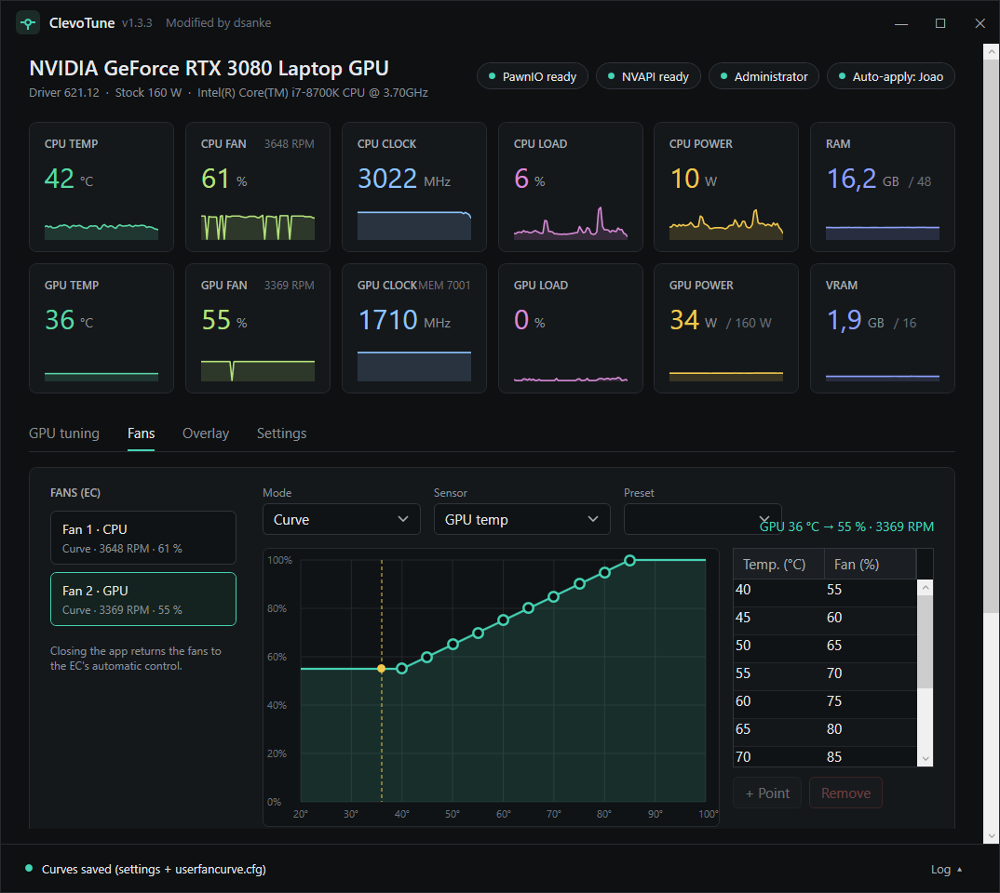

# ClevoTune

[](https://github.com/j0p3s/Clevo-tuner/releases/latest)


A monitoring, GPU tuning and fan control tool for the **Clevo P775DM3-G** (Intel Core i7-8700K + NVIDIA GeForce RTX 3080 Laptop GPU) on Windows 10/11.

ClevoTune shows live CPU, GPU and memory sensors, applies GPU clock offsets, power limits and clock locks, and replaces the laptop's built-in fan behavior with your own temperature-based or load-based fan curves. It ships as a single `.exe` (or an equivalent `.cmd`), with no installer.



**[⬇ Download the latest release](https://github.com/j0p3s/Clevo-tuner/releases/latest)**: get `ClevoTune (vX.Y.Z).zip`, extract it to a permanent folder and run `ClevoTune (vX.Y.Z).exe`.

> **Warning:** ClevoTune writes directly to the laptop's embedded controller (EC) and changes GPU clocks. That is the same kind of access vendor tools use, but it is still low-level hardware control. Use it at your own risk and watch your temperatures when you try new settings.

---

## Contents

- [Features](#features)
- [Requirements](#requirements)
- [Package contents](#package-contents)
- [First launch](#first-launch)
- [Using the program](#using-the-program)
  - [Sensor dashboard](#sensor-dashboard)
  - [GPU tuning tab](#gpu-tuning-tab)
  - [Profiles](#profiles)
  - [Fans tab](#fans-tab)
  - [Overlay tab](#overlay-tab)
  - [Settings tab](#settings-tab)
  - [Tray icon](#tray-icon)
- [Fan control in detail](#fan-control-in-detail)
- [ClevoFanControl curve files](#clevofancontrol-curve-files)
- [mVolt+ integration](#mvolt-integration)
- [Starting with Windows / Task Scheduler](#starting-with-windows--task-scheduler)
- [Languages](#languages)
- [Files and locations](#files-and-locations)
- [Command line](#command-line)
- [How it works (technical)](#how-it-works-technical)
- [Troubleshooting](#troubleshooting)
- [Limitations](#limitations)
- [Uninstalling](#uninstalling)
- [Credits](#credits)
- [Building from source](#building-from-source)
- [Changelog](#changelog)

---

## Features

- **Live dashboard** with 12 sensor cards and 60-second history graphs: CPU temperature, fan, clock, load and package power, RAM, and GPU temperature, fan, core/memory clock, load, power (with the current limit) and VRAM.
- **GPU tuning** through NVIDIA's own driver interfaces:
  - core clock offset and memory clock offset (NVAPI)
  - power limit (TGP), when the vBIOS allows it (NVML, with the NVAPI power target as a fallback for laptop GPUs)
  - maximum clock limit (NVML clock lock). Combined with a positive core offset, this gives the usual Ampere undervolt.
- **mVolt+ integration** (optional): when the NVIDIA driver blocks the power limit, ClevoTune sets it through [mVolt+](https://github.com/b00nz/mVolt)'s command line. It also adds a core voltage offset slider driven by mVolt+.
- **Profiles** that store the GPU settings. The last profile you saved is applied automatically every time the app opens.
- **Custom fan control** for the CPU fan and the GPU fan:
  - **Auto (EC)**: the laptop's own fan behavior
  - **Curve**: speed follows a curve you draw or type in a table
  - **Fixed**: constant speed
  - curve input can be CPU temperature, GPU temperature, the hotter of the two, CPU load, GPU load, or the higher load
  - hysteresis, smooth ramp-down, load smoothing and a safety temperature that forces 100%
- **ClevoFanControl compatibility**: import and export `userfancurve.cfg`, plus an optional fixed 40–85 °C grid that matches that program.
- **Automatic setup**: on first launch it downloads and installs the signed PawnIO driver and the official PawnIO modules it needs.
- **Tray mode**: keeps controlling the fans with the window closed.
- **Start with Windows** through a scheduled task, without a UAC prompt.
- **On-screen overlay** with temperatures, loads, power, clocks and fan speeds.
- **6 built-in languages** (English, Portuguese, French, Spanish, German, Italian), stored in editable `.lng` files with English as the base. You can add new languages yourself.

---

## Requirements

| | |
|---|---|
| Laptop | Clevo P775DM3-G. Other Clevo models that use the same EC fan commands may work but are untested. |
| OS | Windows 10 or 11, 64-bit |
| CPU | Intel. CPU temperature and power need Intel MSR access through PawnIO. |
| GPU | NVIDIA with a current driver. `nvml.dll` and `nvapi64.dll` come with the driver. |
| Rights | Administrator. The `.exe` asks for it automatically. |
| Runtime | Windows PowerShell 5.1 and .NET Framework 4.8. Both are built into Windows 10/11. |
| Internet | Only on first launch, to download PawnIO and its modules |

Close or uninstall **Clevo Control Center** before you use the fan curves. Otherwise it keeps rewriting the fan speeds and fights with ClevoTune.

---

## Package contents

```
ClevoTune (vX.Y.Z).exe    the program (recommended)
ClevoTune (vX.Y.Z).cmd    the same program as a script, same features
Language\                 translation files (en-us.lng, pt.lng, fr.lng, es.lng, de.lng, it.lng)
README.md                 this file
CHANGELOG.md              version history
```

On the first start ClevoTune adds the `modules` folder (PawnIO modules) and the `mVolt+` folder (mVolt+ and its `version.txt`) next to the program.

Use the `.exe` or the `.cmd`, not both at the same time. Only one instance can run; opening a second one brings the existing window to the front.

The `.exe` is not code-signed, so Windows SmartScreen may warn the first time. Choose **More info → Run anyway**. If Windows blocks the downloaded zip, open the zip's **Properties**, tick **Unblock** and click OK before you extract it.

---

## First launch

1. Extract the zip to a permanent folder, for example `C:\Tools\ClevoTune`.
2. Run `ClevoTune (vX.Y.Z).exe` and accept the UAC prompt.
3. If PawnIO is missing, a small setup window appears and ClevoTune:
   - downloads the official `PawnIO_setup.exe` from the PawnIO GitHub releases
   - checks its Authenticode signature and refuses to run it if the signature is not valid
   - installs it silently (`-install -silent`)
   - downloads the latest PawnIO.Modules release and extracts `LpcACPIEC.bin` (EC/fan access) and `IntelMSR.bin` (CPU temperature/power) into the `modules` folder
4. The main window opens. If Windows asks for a restart to activate the driver, the status bar says so. Fans and CPU sensors become available after the restart.

You can repeat this step at any time with **Settings → Reinstall driver + modules**.

---

## Using the program

### Sensor dashboard

The top of the window shows the GPU name, driver version, stock power limit and CPU model. Next to them are status chips:

| Chip | Meaning |
|---|---|
| PawnIO ready / partial / missing | whether EC (fan) and MSR (CPU) access are working |
| NVAPI ready / unavailable | whether GPU clock offsets can be read and written |
| Administrator / No admin | whether the app has the rights it needs |
| Auto-apply: *profile* | the profile that is applied when the app opens |

Below are 12 cards with the current value and a 60-second graph:

| Card | Source |
|---|---|
| CPU TEMP | package temperature from Intel MSR (`IA32_PACKAGE_THERM_STATUS`, TjMax from `MSR_TEMPERATURE_TARGET`) |
| CPU FAN | EC fan 1 duty (%) and RPM |
| CPU CLOCK | Windows performance counter (`% Processor Performance` × base clock) |
| CPU LOAD | Windows performance counter (`% Processor Utility`) |
| CPU POWER | Intel RAPL package energy counter |
| RAM | used / total physical memory |
| GPU TEMP / CLOCK / MEM / LOAD / POWER / VRAM | NVIDIA NVML |
| GPU FAN | EC fan 2 duty (%) and RPM |

### GPU tuning tab

| Control | What it does |
|---|---|
| **Power limit (TGP)** | Sets the GPU power limit. ClevoTune first tries NVML; laptop GPUs usually answer *Not Supported*, so it then sets the NVAPI power target (% of the default limit, the same control MSI Afterburner calls *Power Limit*). The slider range comes from the vBIOS. If neither method is allowed, the slider is disabled and shows "locked by vBIOS/driver"; this is remembered for the current driver version and checked again after a driver update. On the P775DM3-G's RTX 3080 both methods are refused; if mVolt+ is available, ClevoTune then applies the limit with `mVolt+ --power <percent of default>` and reads the enforced value back with `--status`. |
| **Core clock offset** | Shifts the whole GPU core clock/voltage curve (NVAPI P-State 2.0). The range comes from the driver. |
| **Memory clock offset** | Shifts the memory clock (NVAPI). Values are in the driver's own units, which can differ from other tools' display. |
| **Core voltage offset (mVolt+)** | Changes the core voltage demand with `mVolt+ --core-vdemand` (−250…+100 mV). Negative values undervolt. Enabled only when mVolt+ is found. |
| **Max clock limit** | Locks the maximum GPU core clock (NVML `SetGpuLockedClocks`). Because the GPU reaches its highest clocks at its highest voltages, capping the clock also caps the voltage. |

- **Apply to GPU** writes all four values.
- **Reset to stock** restores the default power limit, sets both offsets to 0 and removes the clock lock.
- **Refresh readback** reads the current values back from the card.
- Each row shows what is actually on the card ("on card: …") next to the slider value.

**Undervolting on Ampere:** set a clock limit (e.g. 1800 MHz) and a positive core offset (e.g. +150 MHz). The GPU then reaches 1800 MHz at the voltage it would normally use for about 1650 MHz. ClevoTune does not set an absolute voltage. Public NVIDIA interfaces do not allow that on RTX 30 series cards, so use a dedicated tool such as mVolt+ for direct voltage control.

Offsets and clock locks stay active until reboot or driver reset. Use a profile with auto-apply to restore them at every start.

### Profiles

- **Load** fills the sliders with the selected profile. **Apply** then writes them to the GPU.
- **Save as…** stores the current slider values under a name, replacing a profile with the same name if you confirm.
- **Delete** removes the selected profile. At least one profile must remain.
- **Apply the last profile on open** (on by default): every time ClevoTune opens, it applies the profile you saved most recently. The built-in `Stock` profile alone is never auto-applied.
- **Start with Windows (at sign-in)**: see [Starting with Windows](#starting-with-windows--task-scheduler).

A profile stores the power limit (0 = leave unchanged), core offset, memory offset, clock limit (0 = off) and core voltage offset (mVolt+).

### Fans tab

The P775DM3-G has two fans:

| Fan | Default input |
|---|---|
| Fan 1 · CPU | CPU temperature |
| Fan 2 · GPU | GPU temperature |

Select a fan on the left, then choose:

- **Mode**: Automatic (EC), Curve or Fixed.
- **Sensor** (input for the curve):
  - CPU temp, GPU temp, Max CPU/GPU temp
  - CPU load, GPU load, Max CPU/GPU load
- **Preset**: fills the curve with Quiet, Balanced, Cool or Maximum. Load inputs get load-specific presets.

**Editing a curve**

- Type values in the table: temperature (or load %) and fan %.
- Drag the points on the graph.
- Double-click the graph to add a point; right-click a point to remove it.
- **+ Point** / **Remove** add or remove rows.
- The yellow dashed line shows the current input value and the yellow dot the current fan speed.

**Fixed 40–85 °C grid (like ClevoFanControl):** locks the curve to 10 points at 40, 45, … 85. Only the fan % can change, by editing the table or dragging points vertically.

**Buttons**

| Button | Action |
|---|---|
| Import .cfg | loads a ClevoFanControl `userfancurve.cfg` |
| Export .cfg | saves your curves in that format |
| Save curves | saves the settings and writes `userfancurve.cfg` next to the program |
| Return all to EC (auto) | gives both fans back to the laptop's automatic control |

Curves are also saved to the settings automatically whenever you change them.

**Behavior settings**

| Setting | Default | Effect |
|---|---|---|
| Hysteresis | 3 | The fan only slows down after the input has dropped this many °C (or % load) below the level that raised it. This stops the fan from hunting around a threshold. |
| Max ramp-down | 3 %/s | How fast the fan may slow down. Speeding up is always immediate. |
| Load smoothing | 3 s | Averaging window for load inputs, so short spikes don't rev the fans. 0 = off. |
| Safety temperature | 92 °C | If the CPU or GPU reaches this, every fan in Curve or Fixed mode goes to 100%, including load-based curves. |

### Overlay tab

A small always-on-top text box with CPU (temp/load/W), GPU (temp/load/W), GPU clocks, fan speeds and RAM/VRAM.

- Choose the corner, font size, background opacity and which lines to show.
- It is click-through, so it never blocks the mouse.
- It shows over windowed and borderless games but not over exclusive full-screen games.
- It does not show FPS.

### Settings tab

- **mVolt+**: shows the installed mVolt+ version and path. **Check for mVolt+ updates** checks GitHub now and installs a newer release; **mVolt+ website** opens the project page. See [mVolt+ integration](#mvolt-integration).

- **Hardware access (PawnIO)**: status of the driver, the EC module, the MSR module, NVML and NVAPI. Buttons:
  - **PawnIO website**
  - **Reinstall driver + modules**: downloads and installs everything again
  - **Open modules folder**
  - **Reinitialise sensors**: reloads the driver connections without restarting the app
- **Application**:
  - **Start with Windows (at sign-in)**: starts ClevoTune in the tray when you sign in
  - **Closing the window minimises to the tray**: when on, the X button hides the window and fan control keeps running
  - **Polling interval**: 500, 1000 or 2000 ms
  - **Language**: automatic (follows Windows) or any language found in the `Language` folder
  - **Open language folder**
  - the paths of the program, modules, settings and language files

### Tray icon

The tooltip shows the current CPU and GPU temperatures. Left-click or double-click opens the window. Right-click menu:

- Open ClevoTune
- Apply profile: *name*, one entry per profile
- Fans → automatic (EC)
- Start with Windows (checkable)
- Exit (returns fans to the EC)

---

## Fan control in detail

Every polling interval ClevoTune:

1. reads the CPU temperature (MSR), GPU temperature and load (NVML), CPU load (performance counters) and each fan's duty, RPM and EC temperature
2. for each fan in **Curve** mode, takes the selected input, applies load smoothing (load inputs only) and hysteresis, then reads the target % from the curve by linear interpolation. Below the first point it uses the first value; above the last point it uses the last value.
3. applies the safety temperature: 100% if the CPU or GPU is at or above it
4. limits how fast the fan can slow down (ramp-down)
5. writes the duty to the EC when it changes, and at least every 3 seconds so the EC does not drift back

**Fallbacks**

- If the CPU temperature can't be read from the MSR, the EC's own CPU temperature is used.
- If a fan's curve input becomes unavailable, that fan is returned to EC automatic mode until the reading comes back.

**When the app closes**

- **Exit** in the tray menu, closing the window (when not minimising to the tray), Windows shutdown and logoff all return both fans to **EC automatic mode**.
- If the process is killed forcibly (for example from Task Manager), the fans stay at their last speed until ClevoTune runs again or the laptop restarts.

---

## ClevoFanControl curve files

ClevoTune reads and writes the `userfancurve.cfg` format used by [ClevoFanControl](https://github.com/djsubtronic/ClevoFanControl). It is a plain text file with 20 lines:

```
lines 1–10   CPU fan % at 40, 45, 50, 55, 60, 65, 70, 75, 80, 85 °C
lines 11–20  GPU fan % at 40, 45, 50, 55, 60, 65, 70, 75, 80, 85 °C
```

**Import**

- Sets both fans to Curve mode with CPU/GPU temperature input and turns on the fixed grid.
- A file with only 10 values is applied to the selected fan.
- On the very first launch, a `userfancurve.cfg` placed next to the program is imported automatically.

**Export**

- Writes the CPU and GPU curves in the same format.
- If a curve has points outside the 40–85 grid, the 10 values are calculated by interpolation and the log says so.

---

## mVolt+ integration

[mVolt+](https://github.com/b00nz/mVolt) by b00nz is a separate NVIDIA tuning tool that can change settings the normal driver interfaces refuse on some GPUs. ClevoTune does not include it; it only runs it through its documented command line when it is available.

- **Where it is kept:** `mVolt+\mVolt+.exe` in the same folder as the ClevoTune `.exe`/`.cmd`, with the installed release tag in `mVolt+\version.txt`. If that folder is read-only, `%APPDATA%\ClevoTune\mVolt+` is used.
- **Automatic install and updates:** at startup (at most every 12 hours) ClevoTune checks the latest release on GitHub (`b00nz/mVolt`). If the local copy is missing or older, it downloads the release and replaces `mVolt+.exe`. If the file is in use, the update is installed on the next start. **Settings → Check for mVolt+ updates** checks immediately. While no local copy exists (e.g. offline), an installed mVolt+ in `%ProgramFiles%\mVolt+` or `%LOCALAPPDATA%\mVolt+` is used.
- **Power limit:** if NVML and the NVAPI power target both refuse, ClevoTune uses mVolt+:
  - below the default limit: `--power-cap-watts <W>` (lowers the limit)
  - exactly the default: `--return-to-percentage` (releases the cap)
  - above the default: `--power <whole-number percent>`, then `--power-cap-watts <W>` if the percentage control is unavailable
  - afterwards `--status` is read and the enforced limit is shown as "on card: … W (mVolt+)". If the card enforces less than requested, that value is remembered as the real maximum for this driver and the slider is capped there.
  - On the P775DM3-G's RTX 3080, mVolt+ can lower the limit but not raise it above the 160 W default.
  - If mVolt+ refuses everything, the slider is disabled for this driver version. A power value equal to what the card already enforces is not sent again.
- **Core voltage offset:** runs `mVolt+ --core-vdemand <mV>` whenever the value differs from the one last applied.
- Power and voltage are sent in separate mVolt+ calls, so a refused option doesn't block the other. Every command, exit code and output is written to the log.
- mVolt+ needs administrator rights, which ClevoTune already has. Settings applied by mVolt+ stay active after it exits; use a profile with auto-apply to restore them at every start.
- mVolt+ is a third-party program; check its README before using its voltage controls.

## Starting with Windows / Task Scheduler

**From the app (recommended):** enable **Start with Windows (at sign-in)**. The option is in three places that stay in sync: **Settings → Application**, the **Profiles** panel, and the tray menu (**Start with Windows**, with a check mark). It creates a scheduled task named `ClevoTune` that:

- runs at your logon with highest privileges, so there is no UAC prompt
- starts ClevoTune minimised to the tray (`/tray`) after a 15-second delay, so the NVIDIA driver is ready
- has no time limit and keeps running on battery

Turn the option off to delete the task. If you move or rename the program, turn the option off and on again so the task points to the new location.

**Creating the task manually**

| Field | Value |
|---|---|
| Program | full path to `ClevoTune (vX.Y.Z).exe` |
| Arguments | `/tray` (optional, starts hidden in the tray) |
| General | tick **Run with highest privileges**. Without it the task fails with error 740 (elevation required). |
| Settings | untick **Stop the task if it runs longer than…** |

---

## Languages

The interface is available in **English, Portuguese, French, Spanish, German and Italian**. English is the base language: every translation file maps the original English text to its translation. By default it follows the Windows display language and falls back to English. You can change it in **Settings → Language**; the change takes effect immediately.

Translations are plain UTF-8 text files in the `Language` folder next to the program:

```
Language\en-us.lng
Language\pt.lng
Language\fr.lng
Language\es.lng
Language\de.lng
Language\it.lng
```

Each file looks like this:

```ini
; comment
[info]
name=Français
code=fr
base=en
version=1.6.2

[strings]
GPU tuning=Réglage GPU
Ready=Prêt
```

**Editing rules**

- Edit only the text **after the first `=`**. The text before it is the original English text and is the lookup key.
- A missing or empty line falls back to the built-in translation, or to English for a language that is not built in.
- `{0}`, `{1}` … are placeholders for values such as numbers or profile names. Keep them in the translation.

**How the files are managed**

- ClevoTune creates missing files on startup and never overwrites your edits.
- When a new version adds texts, they are appended to the end of the built-in files.
- **Adding a language:** copy `en-us.lng` to a new name (for example `nl.lng`), set `name=` and `code=`, and translate the text after each `=`. It then appears in the language list.
- Files from versions before 1.4.0 used Portuguese as the key. They are converted to English keys automatically, your edits are kept, and the original is saved as `<name>.lng.old`.

If the program folder is not writable, the language files are kept in `%APPDATA%\ClevoTune\Language`.

---

## Files and locations

| Path | Contents |
|---|---|
| `<program folder>\modules\` | `LpcACPIEC.bin`, `IntelMSR.bin` (PawnIO modules); a shared copy is kept in `%APPDATA%\ClevoTune\modules` so a new program folder (e.g. a new version) doesn't download them again |
| `<program folder>\Language\` | `.lng` translation files (English base) |
| `<program folder>\userfancurve.cfg` | written by **Save curves** |
| `<program folder>\mVolt+\` | `mVolt+.exe` and `version.txt` (kept up to date automatically) |
| `%APPDATA%\ClevoTune\config.json` | all settings: profiles, fan curves, overlay, language, etc. |
| `%APPDATA%\ClevoTune\clevotune.log` | activity log, reset at 512 KB |
| `%LOCALAPPDATA%\ClevoTune\` | compiled core DLL cache, and the script extracted by the `.exe` |

If the program folder is not writable, `modules`, `Language` and `userfancurve.cfg` fall back to `%APPDATA%\ClevoTune\`.

---

## Command line

```
"ClevoTune (vX.Y.Z).exe" /tray
```

`/tray` (or `-tray`) starts minimised to the tray. If **Start with Windows** is on, the last saved profile is applied.

---

## How it works (technical)

- **Program structure**
  - The `.exe` is a small .NET Framework 4.8 launcher with an administrator manifest. It extracts the embedded PowerShell script to `%LOCALAPPDATA%\ClevoTune` and runs it with Windows PowerShell 5.1, with no console window.
  - The `.cmd` is the same script with a batch header that asks for administrator rights.
  - The user interface is WPF.
  - Hardware access is a C# core that is compiled on first run and then cached.
- **Fans (EC)**
  - Access goes through the PawnIO `LpcACPIEC` module, which only allows the standard ACPI EC ports `0x62/0x66`. The `Global\Access_EC` mutex is used so other EC readers (HWiNFO, LibreHardwareMonitor) are not disturbed.
  - Commands, per fan *n*:
    - `0x99 n duty` sets the fan duty (0–255)
    - `0x99 0xFF n` returns the fan to automatic mode
    - `0x9E n` reads the EC temperature and duty
    - registers `0xD0+2(n-1)` (high byte) and `0xD1+2(n-1)` (low byte) read the tachometer, with RPM = 2156220 / raw
  - These are the commands used by existing Clevo fan tools (Tuxedo's open-source fan control and ClevoFanControl).
- **CPU**: PawnIO `IntelMSR` module (read-only use): package thermal status, TjMax, and the RAPL package energy counter for power.
- **GPU**
  - NVML (`nvml.dll`): sensors, power limit, clock lock.
  - NVAPI (`nvapi64.dll`): core and memory offsets, using `NvAPI_GPU_GetPstates20` / `NvAPI_GPU_SetPstates20` on the P0 state, and the power target through `NvAPI_GPU_ClientPowerPolicies*` when NVML can't change the power limit.
- **CPU load and clock**: Windows PDH counters, using English counter names so they work on any Windows language.
- **Dependencies**: PawnIO is installed from its official GitHub release after its Authenticode signature is checked. Modules come from the latest official PawnIO.Modules release.

---

## Troubleshooting

| Problem | What to do |
|---|---|
| "PawnIO missing" / fans unavailable | Use **Settings → Reinstall driver + modules**, then restart Windows if asked. Check the log (**Log** button, bottom right). |
| Fans don't follow the curve | Close Clevo Control Center. Confirm that the fan is in **Curve** mode, then check that **Fixed 80 %** changes the RPM. |
| GPU offsets fail | Check the NVAPI chip and the log. Some drivers or vBIOSes lock the memory offset or the power limit. |
| Power limit slider disabled, or "Power … W: … Not Supported" | Neither NVML nor the NVAPI power target is allowed by this vBIOS/driver. The log shows both results and the NVAPI power range read at startup. |
| Task Scheduler start fails (error 740) | Tick **Run with highest privileges** in the task. |
| Nothing happens when launching | Another instance is already running in the tray. |
| SmartScreen / blocked file | Unblock the zip in its Properties before extracting, or choose **More info → Run anyway**. |
| Text not translated | The string is missing from the `.lng` file; it falls back to the built-in text. Add the line yourself. |

The log (`%APPDATA%\ClevoTune\clevotune.log`) records every apply result, fan mode change, download and error.

---

## Limitations

- Made for and tested only against the **P775DM3-G** EC layout with two fans (CPU and GPU).
- Absolute GPU voltage can't be set on RTX 30 series through public interfaces; use the clock limit + offset method instead.
- The RTX 3080 Laptop GPU in the P775DM3-G refuses power-limit changes through both NVML and NVAPI (the vBIOS locks them); ClevoTune uses mVolt+ for that when it is installed.
- The overlay does not show FPS and does not appear over exclusive full-screen games.
- Killing the process forcibly leaves the fans at their last speed until ClevoTune runs again or the laptop restarts.

---

## Uninstalling

1. Turn off **Start with Windows (at sign-in)** in the app, or delete the `ClevoTune` scheduled task.
2. Exit from the tray menu, which returns the fans to the EC.
3. Delete the program folder, `%APPDATA%\ClevoTune` and `%LOCALAPPDATA%\ClevoTune`.
4. Optionally, uninstall **PawnIO** from Windows Settings → Apps. Other tools (LibreHardwareMonitor, FanControl) may also use it.

---

## Credits

- [PawnIO](https://pawnio.eu) and PawnIO.Modules by namazso: signed kernel driver and EC/MSR modules
- [ClevoFanControl](https://github.com/djsubtronic/ClevoFanControl) by djsubtronic: `userfancurve.cfg` format
- [mVolt+](https://github.com/b00nz/mVolt) by b00nz: optional power limit and voltage control through its command line
- [Tuxedo Computers fan control](https://github.com/tuxedocomputers/tuxedo-fan-control): Clevo EC fan command reference
- NVIDIA NVML and NVAPI

---

## Building from source

The release files are built from the sources in `src/`:

| Path | Contents |
|---|---|
| `src/app.ps1` | PowerShell application: UI logic, profiles, fans, tray, overlay, setup, mVolt+ |
| `src/core.cs` | C# hardware core: PawnIO (EC, MSR), NVML, NVAPI, PDH, fan controller |
| `src/main.xaml` | WPF window |
| `src/lang.py` | translation table (English base + pt, fr, es, de, it) |
| `src/launcher/` | .NET Framework 4.8 launcher for the `.exe` (manifest, icon, project) |
| `build.py` | combines everything into `ClevoTune.cmd`, `Language/*.lng` and the release files in `dist/` |

Requirements: Python 3 and, for the `.exe`, the .NET SDK (6 or newer; the .NET Framework 4.8 reference assemblies come from NuGet, so it also builds on Linux).

```
python build.py            # ClevoTune.cmd, Language/*.lng, dist/*.cmd, dist/*.exe, dist/*.zip
python build.py --no-exe   # only the script and the language files
```

The C# core is embedded in the script and compiled by Windows PowerShell on the first run (C# 5 / .NET Framework 4.x), then cached in `%LOCALAPPDATA%\ClevoTune`.

---

## Changelog

See [CHANGELOG.md](CHANGELOG.md).
